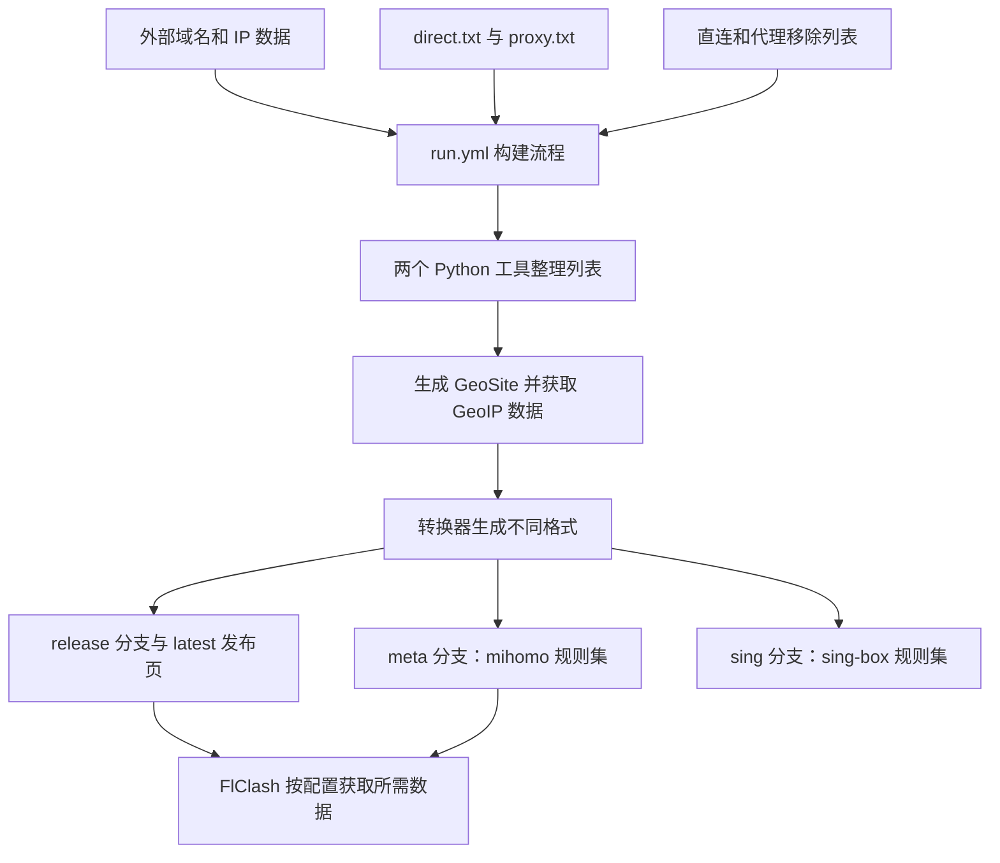

# FlClash 新手教程：怎么使用这个仓库的规则数据

> 本文所说的软件是 **FlClash**（字母 `F` + 小写 `l`）。适用于使用 mihomo / Clash.Meta 内核的 FlClash；不同版本的按钮文字和位置可能略有差别。

阅读导航：前半部分是 FlClash 操作教程；后半部分的 [仓库所有文件逐个说明](#repository-files) 介绍本地文件、发布的数据文件，以及其他分支里的规则集。

## 先弄清楚：这个仓库是什么

这个仓库提供的是供代理软件判断“某个网站或 IP 应该走哪条路线”的**数据**，不是代理软件，也不提供节点、机场账号或订阅链接。仅下载本仓库的文件，不能让你直接获得代理服务。

可以把它想成一张地图：FlClash 是导航软件；你的订阅提供可用的路线；这个仓库提供地名和分类。最终是否直连、代理或拦截，由配置文件里的**规则**决定。

仓库根目录主要是说明和构建脚本；实际可用的数据在 [发布页](https://github.com/MetaCubeX/meta-rules-dat/releases/latest)（二进制数据文件）和 [mihomo 规则分支](https://github.com/MetaCubeX/meta-rules-dat/tree/meta)（`.mrs` 规则集），不是在 `resouces` 文件夹里逐个手工挑选。`resouces` 主要是制作数据时用的原始文本、脚本。

| 文件 | 做什么 | 新手要不要下载 |
| --- | --- | --- |
| `geosite.dat` | 按网站域名分类，例如 `cn`、`youtube` | 推荐让内核按下面的地址获取 |
| `geoip.dat` | 按目标 IP 地址分类，例如 `CN` | 推荐让内核按下面的地址获取 |
| `country.mmdb` | 另一种 IP 地理数据格式 | 本教程用 `geoip.dat`，通常不用手动下载 |
| `geosite-lite.dat`、`geoip-lite.dat` | 缩小版，分类不完整 | 第一次设置先不用 |
| `*.mrs` | 单个分类的 mihomo 规则集 | 想单独添加某一类规则时才用 |
| `*.db`、`*.metadb`、`BundleMRS.7z` | 其他格式或规则集压缩包 | 第一次设置先不用 |

**最容易弄错的地方：**发布页的 `.dat`、`.mmdb`、`.mrs` 不能直接当 FlClash 的“订阅链接”导入。FlClash 要导入的是一个 mihomo / Clash.Meta **配置**（通常是 `.yaml`/`.yml` 文件或提供这种配置的订阅地址）。

## 你需要准备什么

1. 已安装 [FlClash](https://github.com/chen08209/FlClash/releases/latest)。Windows、Android、macOS、Linux 都可用。Android 第一次启动时按提示授予 VPN 连接权限。
2. 一个**你自己已有的**、能在 FlClash 中使用的 mihomo / Clash.Meta 订阅链接或配置文件。请从你的服务提供方获取；不要把订阅链接公开发给别人。
3. 能打开用于下载规则文件的网址。第一次更新可能要等一会儿；下载不成功时看后面的“排错”。

如果你已经在 FlClash 中正常使用订阅，直接从“第二步”继续。

## 第一步：让 FlClash 本身先能正常使用

1. 打开 FlClash，找到 **配置 / Profiles** 页面，点 **添加 / ＋**，选择 **从 URL 导入**（或类似文字）。
2. 粘贴你已有的订阅链接，确认导入；如果服务方给的是 `.yaml` 文件，则选择**从文件导入**。**不要在此处粘贴本仓库的 `geoip.dat` 或 `geosite.dat` 地址。**
3. 在配置列表中选中刚导入的配置；打开 **代理 / Proxies**，在订阅提供的代理组中选一个能用的节点。
4. 把运行模式选为 **规则 / Rule**。如果选了 **全局 / Global** 或 **直连 / Direct**，下面添加的分流规则不会按预期工作。
5. 启动 FlClash。Windows/macOS/Linux 需要按需打开 **系统代理**；想接管更多应用流量时再考虑 TUN。Android 按系统提示开启 VPN。先确认浏览器可以正常访问网站。

**到这里如果没有联网成功，先检查订阅和节点。**这个仓库的数据不能修复已失效的节点。

## 第二步：备份当前配置并找到编辑入口

接下来的例子会修改 **mihomo 配置文件**，不是修改 FlClash 安装包。先在 FlClash 的配置页找 **复制、导出、另存为** 或 **编辑**。你可以备份现有配置并保存一份本地副本，再编辑这份副本；不同版本菜单位置不一样，可从配置卡片的 `⋮` 菜单找。实在找不到编辑器，可以在电脑上用文本编辑器打开自己的 `.yaml` 文件，改好后通过 FlClash 的“从文件导入”重新导入。

如果你编辑的是**订阅生成的配置**，下次更新订阅可能会覆盖你的修改。FlClash 支持配置覆写和自定义规则；熟悉它们后，可以把长期要用的修改放在覆写中。第一次照做时，先用**备份后的本地配置文件**最容易检查和恢复。

编辑时先找文件顶层有没有 `geodata-mode:`、`geox-url:` 和 `rules:`。顶层指与 `mode:`、`rules:` 等字段左侧对齐，**前面没有空格**；若字段已经存在，请修改原字段，不要在同一层重复添加第二份。改文件前把原文备份一份；别把订阅中的节点、密码等内容发到公开网站。

## 第三步：让配置使用本仓库的 GeoSite、GeoIP 数据

在配置文件顶层加入以下内容，保存后回到 FlClash 选中这份配置并重新加载。以下是**真实下载地址**，可以直接复制：

```yaml
geodata-mode: true
geo-auto-update: true
geo-update-interval: 24
geox-url:
  geoip: "https://testingcf.jsdelivr.net/gh/MetaCubeX/meta-rules-dat@release/geoip.dat"
  geosite: "https://testingcf.jsdelivr.net/gh/MetaCubeX/meta-rules-dat@release/geosite.dat"
  mmdb: "https://testingcf.jsdelivr.net/gh/MetaCubeX/meta-rules-dat@release/country.mmdb"
```

`geodata-mode: true` 表示 GEOIP 使用 `.dat` 模式；`geox-url` 告诉 mihomo 在获取或更新 GEO 数据时去哪里下载。`geo-auto-update: true` 开启自动更新，`geo-update-interval: 24` 表示更新间隔为 24 小时。上面 `mmdb` 的地址是供需要 MMDB 的场景使用；它不代表要自己手工下载三个文件。**改地址不会立刻替换已经缓存的数据**；可以在 FlClash 的 GEO 数据更新入口手动更新（若当前版本提供），或等待下次自动更新，之后再按第五步查看连接和日志。

**只改下载地址，不一定会改变网站走直连还是代理。**要让它参与分流，当前配置的 `rules:` 中还需要有 `GEOSITE` / `GEOIP` 规则。如果订阅本来就有这些规则，可以先不改 `rules:`，检查现有规则是否满足需求。

在已有配置里查找 `rules:`，例如看到：

```yaml
rules:
  - GEOSITE,cn,DIRECT
  - GEOIP,CN,DIRECT
  - MATCH,某个已有的代理组
```

其含义依次是：国内域名直连、国内 IP 直连、没命中前面规则的流量交给最后的代理组。**这段是阅读示意，不能原样粘贴**：`某个已有的代理组` 必须是你的配置中真实存在的代理组名称，而且你的原配置可能还有其他重要规则。

如果你想手动在原有 `rules:` 下添加分类规则，可参考：

```yaml
  - GEOSITE,cn,DIRECT
  - GEOIP,CN,DIRECT
```

把它们放在已有 `rules:` 的列表里，通常放在最后那条 `MATCH,...` **之前**；不要再写一个新的 `rules:` 顶层字段。规则由上到下匹配，先命中的规则生效；如果前面已有覆盖范围更大的规则，你新增的规则可能根本到不了。修改国内直连规则可能影响某些需要代理的站点，优先保留订阅原有的细分规则和顺序。

可以用 [GitHub Release 的 `geoip.dat`](https://github.com/MetaCubeX/meta-rules-dat/releases/download/latest/geoip.dat) 和 [`geosite.dat`](https://github.com/MetaCubeX/meta-rules-dat/releases/download/latest/geosite.dat) 代替上方 `geox-url` 的两个地址；如果当前网络连不上某个下载源，试另一个。注意 **`.dat` 是数据文件，不能在 `rule-providers` 中当 `.mrs` 规则集用。**

## 第四步（可选）：给现有配置添加一份独立的“国内域名直连”规则集

如果你的配置不使用 `GEOSITE`，只想使用这个仓库的某一个分类，可以用 `.mrs` 规则集。例如，按以下步骤加入 `cn.mrs`：

1. 在配置文件顶层找到 `rule-providers:`。没有就创建；已有则**在原有字段下面**加入 `cn-from-meta-rules-dat:`，不要再创建第二份 `rule-providers:`。
2. 新增下面这段（`rule-providers:` 已存在时，只复制其下方缩进的部分）：

   ```yaml
   rule-providers:
     cn-from-meta-rules-dat:
       type: http
       behavior: domain
       format: mrs
       url: "https://raw.githubusercontent.com/MetaCubeX/meta-rules-dat/meta/geo/geosite/cn.mrs"
       path: ./ruleset/meta-geosite-cn.mrs
       interval: 86400
   ```

3. 在**原有** `rules:` 列表里插入这一行，放在宽泛的匹配规则和最后的 `MATCH` 之前：

   ```yaml
     - RULE-SET,cn-from-meta-rules-dat,DIRECT
   ```

4. 保存、重新加载配置，等待规则集下载。`interval: 86400` 表示规则集的更新间隔为 86400 秒（一天）。

这个例子只让 `cn.mrs` 里的域名直连；其他网站怎么走，仍取决于你原来的规则。`DIRECT` 表示直连，`REJECT` 表示拒绝连接；如果要让某个规则走代理，需要填写**配置中实际存在的代理组名**，不要把示例里的说明文字当成名字。域名规则集的 `behavior` 是 `domain`；如果以后用 `geo/geoip/` 下的 IP 规则集，则应使用 `ipcidr`。

本仓库 README 里的 `dns: nameserver-policy:` 是进阶示例；第一次只改分流无需照搬整段示例，也不要直接把原配置文件全部替换掉。

## 第五步：怎么确认已经生效

1. 保持 FlClash 的运行模式为 **规则 / Rule**，当前使用的配置是你改过的那份。
2. 打开一个常用国内网站，再打开一个你平时通过代理访问的网站。
3. 在 FlClash 的 **连接 / Connections** 或 **日志 / Logs** 里看新连接，留意显示的规则和出站是 `DIRECT` 还是某个代理组。旧连接可能保持原路线；测试时可刷新页面或关闭旧连接后再试。
4. 如果添加了 `.mrs`，看日志里是否出现规则集下载失败；成功加载后，国内网站连接应能命中 `RULE-SET,cn-from-meta-rules-dat,DIRECT`，前提是前面没有其他规则抢先命中。

只看到网站能打开，还不能证明新规则生效；**看 FlClash 显示的命中规则和连接去向**更可靠。

## 出问题时从哪里查

| 现象 | 先检查什么 |
| --- | --- |
| 导入 `.dat` 时提示不是配置 | 你把数据文件当成订阅了；按“第一步”导入自己的订阅，按“第三步”填数据下载地址 |
| 改完配置提示 YAML 格式错误 | 检查冒号后空格、缩进、引号；同一顶层是否出现两个 `rules:` / `geox-url:` / `rule-providers:`；把文件恢复成备份逐段修改 |
| 提示找不到代理组 | 新增规则使用了配置中不存在的组名；先用 `DIRECT` 测试，或者复制现有代理组的准确名称（大小写和空格都要一致） |
| `GEOSITE` 类别找不到 | 查看日志确认数据下载成功；先使用完整版 `geosite.dat`，不要把精简版当完整版使用 |
| `.mrs` 下载失败 | 检查链接和网络；URL 要指向 `meta` 分支的 `.mrs` 文件，不是仓库首页；可等网络恢复后重新加载 |
| 规则写了但好像没生效 | 确认是“规则”模式、选中了改过的配置，查看是否有更靠前的规则先匹配，确认新规则在 `MATCH` 前 |
| 更新订阅后修改消失 | 订阅更新覆盖了手工编辑；恢复本地副本，或在支持的 FlClash 版本中改用配置覆写保存修改 |
| 一改就无法上网 | 先切回备份配置，确认订阅/节点本身正常；再一次只改一个地方并查看日志 |

<a id="repository-files"></a>

## 仓库所有文件逐个说明

以下根据本地文件实际内容，以及本地已有的 `upstream/release`、`upstream/meta`、`upstream/sing` 分支记录整理，核对日期为 **2026-11-19**。这些分支记录是本地保存的上游版本；在线仓库继续更新后，文件数量和分类内容可能改变。

各节先列出文件树，再说明大致含义。树中只写目录和文件名，`/` 表示目录，`…` 表示同类文件或更深层内容。文件较少的章节完整列出，规则分支和 Git 管理目录采用代表文件展示结构。

文件树导航：[本地项目](#tree-local) · [release](#tree-release) · [meta](#tree-meta) · [sing](#tree-sing) · [.git](#tree-git) · [用途速查](#tree-purpose)。数据来源见 [上游项目与下载链接](#upstream-sources)。

<a id="tree-local"></a>

### 一、先看文件夹全貌

当前工作目录有 **17 个项目文件**，下面逐个列出。Git 的本地管理文件在第十二节完整展开。

```text
meta-rules-dat/
├─ .github/
│  ├─ workflows/
│  │  ├─ delete.yml
│  │  └─ run.yml
│  └─ dependabot.yml
├─ docs/
│  └─ FlClash-新手教程.md
├─ resouces/
│  ├─ bm7.sh
│  ├─ convert-clash.sh
│  ├─ convert.sh
│  ├─ direct-need-to-remove.txt
│  ├─ direct.txt
│  ├─ findRedundantDomain.py
│  ├─ proxy-need-to-remove.txt
│  ├─ proxy.txt
│  ├─ reject-need-to-remove.txt
│  ├─ reject.txt
│  └─ removeFrom.py
├─ LICENSE
└─ README.md
```

**大致含义：**

| 文件或目录 | 大致含义 |
| --- | --- |
| `README.md` | 项目首页说明、下载地址和配置示例。 |
| `LICENSE` | 开源许可证。 |
| `docs/` | 存放当前这份 FlClash 教程。 |
| `.github/` | GitHub 的构建、发布、清理和依赖更新配置。 |
| `resouces/` | 制作规则所需的自定义列表和处理脚本。 |

`resouces` 是这个仓库实际使用的文件夹名称，拼写就是如此。脚本按这个路径读取文件，照着路径查找即可。

如果通过 Git 克隆项目，还会看到隐藏的 `.git/` 文件夹。它是 Git 保存版本记录的地方，后面单独解释，不计入上述 17 个项目文件。Windows 文件资源管理器中可通过“查看 → 显示 → 隐藏的项目”查看隐藏文件夹。

下面先说明每个本地文件，再介绍发布后供 FlClash 使用的成品。

### 二、根目录和教程文件：3 个

```text
meta-rules-dat/
├─ docs/
│  └─ FlClash-新手教程.md
├─ LICENSE
└─ README.md
```

**大致含义：**

**1. [README.md](../README.md)：项目的首页说明。**

GitHub 打开仓库首页时，下面显示的介绍通常就是这个文件。`.md` 表示 Markdown，是可以排版标题、表格、链接和代码的文字文件。

这里列出了成品的下载地址、完整版与精简版的差异、规则分类来源，以及一段 mihomo 配置示例。表格中的 GitHub Release、JSDelivr、JSDelivr-CF 是不同的下载入口，不代表三套不同用途的数据；缓存更新时间可能不同。

对 FlClash 用户，它主要用来找下载地址、确认某个分类是否包含在数据里。里面的 YAML 示例是配置片段，缺少你自己的节点等信息，不能直接当作完整订阅使用。

**2. [LICENSE](../LICENSE)：GNU GPL 第 3 版许可证全文。**

这个文件说明项目代码的使用、修改和分发条件。它没有文件扩展名，但可以用文本编辑器打开。

如果你只是下载规则供 FlClash 使用，通常不需要编辑它。准备修改并分发这个项目时，应阅读其中对版权声明、许可证和源代码提供等事项的要求。它不参与规则匹配。

**3. [docs/FlClash-新手教程.md](FlClash-新手教程.md)：面向新手的操作与文件说明。**

就是你现在看到的文档。前半部分说明怎样把规则用进 FlClash，后半部分说明项目里每个文件的用途。它只供阅读，不会被 mihomo 当成规则加载。

### 三、`.github`：在 GitHub 上运行的自动化配置，3 个

```text
meta-rules-dat/
└─ .github/
   ├─ workflows/
   │  ├─ delete.yml
   │  └─ run.yml
   └─ dependabot.yml
```

**大致含义：**

`.github` 是 GitHub 识别的项目配置文件夹。“自动化”可以理解成：让 GitHub 的服务器定时替维护者完成下载、整理和发布。单纯把文件夹下载到电脑，并不会自动执行这些任务。

**4. [.github/workflows/run.yml](../.github/workflows/run.yml)：制作规则成品的总流程。**

这是本仓库最主要的构建文件。`.yml` 和 `.yaml` 都是 YAML 文本格式；这个文件描述的是 GitHub Actions 任务，不能作为 FlClash 配置导入。

它声明了三种触发方式：维护者手动启动、每天定时运行，以及向 `master` 分支推送符合条件的修改。定时表达式 `30 22 * * *` 对应 UTC 每天 22:30，也就是北京时间次日 06:30；这是计划时间，实际执行可能排队。仅修改匹配 `**/README.md` 的文件会跳过这里的推送触发；教程等其他文件并不在这个排除项中。

它按以下步骤制作成品：

1. 取回本仓库，以及 `domain-list-custom`、`domain-list-community`、`meta-rules-converter` 等外部项目。
2. 下载国内域名、GFWList 和其他分类数据，整理成临时的直连、代理候选列表。
3. 把本仓库的 `direct.txt`、`proxy.txt` 合进去。
4. 调用两个 Python 脚本去掉冗余域名，再按两个 `*-need-to-remove.txt` 文件扣掉指定条目。
5. 补充或整理 Google、Apple、OneDrive、Steam、Tracker 等分类，生成完整版和精简版 `geosite.dat`。
6. 获取 GeoIP 数据，把数据转换成 `.db`、`.metadb`，并拆分成 mihomo 和 sing-box 各自使用的规则集。
7. 生成 `BundleMRS.7z`，收集成品，给每个成品生成 SHA-256 校验文件。
8. 更新名为 `latest` 的发布版本，把成品分别发布到 `release`、`meta`、`sing` 分支，再请求刷新 JSDelivr 缓存。

流程中出现的 `temp-direct.txt`、`temp-proxy.txt`、`community/`、`custom/`、`publish/`、`meta-rule/`、`sing-rule/` 等，是执行过程中下载或生成的目录和中间文件。当前工作目录里看不到它们是正常的。

两个容易误读的地方：部分步骤标题还写着从 `hidden` 分支读列表，但实际命令读取的是当前检出的 `./resouces/` 文件；发布步骤标题写着 `meta-rule`、`sing-rule`，实际创建的远程分支名称是 `meta`、`sing`。应以命令实际读取、写入的位置为准。

对普通 FlClash 用户，这个文件解释了“数据是怎么做出来的”。只有打算维护自己的规则版本时，才需要研究和修改这里的流程。

**5. [.github/workflows/delete.yml](../.github/workflows/delete.yml)：清理旧的 Actions 运行记录。**

每次自动构建都会留下运行记录和日志。这个任务调用 `GitRML/delete-workflow-runs`，设置 `retain_days: 7`，用于清理超过保留期的工作流运行记录；它不负责删除你的 FlClash 配置或规则分类。

这里的实际定时配置是 `0 0 * * 0`，表示 **每周日 UTC 00:00，即北京时间周日 08:00**。文件中的英文注释写成了“每月 1 日”，与表达式不一致，实际应按表达式理解。

任务需要仓库设置里名为 `AUTH_PAT` 的凭据。它是维护 GitHub 任务使用的授权信息，和节点、订阅密码无关。Fork 后是否能运行，还取决于自己的 Actions 设置和授权情况。

**6. [.github/dependabot.yml](../.github/dependabot.yml)：检查自动化组件的新版本。**

Dependabot 是 GitHub 提供的依赖更新工具。此文件只配置了 `github-actions` 这一类依赖，例如 `actions/checkout`、`actions/setup-go`。

配置要求每天按 `Asia/Shanghai` 时区的 07:00 检查，并使用 `-` 作为更新分支名称的分隔符。发现可用更新后，工具可以创建更新请求供维护者处理。

它更新的是构建过程所使用的组件版本。FlClash 节点、Geo 数据内容、手机应用升级都不由这个文件管理。

### 四、`resouces` 中的 6 个文本列表

```text
meta-rules-dat/
└─ resouces/
   ├─ direct-need-to-remove.txt
   ├─ direct.txt
   ├─ proxy-need-to-remove.txt
   ├─ proxy.txt
   ├─ reject-need-to-remove.txt
   └─ reject.txt
```

**大致含义：**

这些 `.txt` 文件是构建时用的原材料。你可以用记事本打开查看；修改它们之后，还要经过构建、发布，并让客户端下载到自己的成品，变化才会进入 FlClash。

先认识三个词：`direct` 表示直连分类，`proxy` 表示代理分类，`reject` 表示拦截分类；`need-to-remove` 表示从候选列表移除。这里的名字表达构建用途，最终网络请求走哪条路线，仍由 FlClash 的分流规则决定。

**7. [resouces/direct.txt](../resouces/direct.txt)：额外加入直连候选分类的域名。**

构建流程会把它追加到 `temp-direct.txt`，经过后续去重和筛选后，参与制作 `cn` 分类。

当前文件是 **空文件，0 条**，表示目前没有额外手动补充的域名。空文件不意味着最终没有国内规则；主要内容来自构建时下载的外部列表。

如果你只是想让自己的 FlClash 将某一个网站直连，使用客户端自定义规则通常更直接。编辑这里适合要制作和发布自己整套规则数据的人。

**8. [resouces/direct-need-to-remove.txt](../resouces/direct-need-to-remove.txt)：从直连候选列表扣掉指定条目。**

当前有 **36 条**，例如 `acg.rip`、`hostloc.com`、`emacs-china.org`；也包含 `top` 这样的条目。构建时，`removeFrom.py` 会把与此文件各行文字相同的候选条目移除。

例如，一个域名被外部数据归入直连候选列表，但维护者希望不把这一条纳入生成结果，就可以通过这个文件扣掉。

**移出直连分类并不等于一定走代理。**它之后可能命中其他分类或兜底规则；而且这个工具是逐行相等比较，不会自动把所有相关子域名一起移除。若更宽的上级域名仍覆盖它，客户端的匹配结果也可能不变。

**9. [resouces/proxy.txt](../resouces/proxy.txt)：额外加入代理候选分类的域名。**

当前有 **2 条**：

```text
supertop.co
hk.chinamobile.com
```

构建会把它追加到 `temp-proxy.txt`，再经过后续处理，参与制作 `geolocation-!cn` 分类。

这里的 `proxy` 表示域名分类。文件中没有代理服务器地址、端口或节点密码；它也不能作为代理订阅导入。

**10. [resouces/proxy-need-to-remove.txt](../resouces/proxy-need-to-remove.txt)：从代理候选列表扣掉指定条目。**

当前有 **3 条**：

```text
ifanr.com
weibo.com
www.baidu.com
```

用途与直连移除文件相同，只是处理对象换成代理候选列表。移出这个分类不会自动创建一条 `DIRECT` 规则；最终还要看客户端其他规则如何处理该域名。

**11. [resouces/reject.txt](../resouces/reject.txt)：预留的拦截补充列表。**

当前为 **空文件，0 条**。在当前 `run.yml` 中，把 reject 列表合入构建的相关命令已被注释，因此这个文件**目前没有参与这条构建流程**。

往这里添加域名，不会仅凭这一步就改变当前流程生成的广告拦截数据。上游数据中的 `category-ads-all` 分类仍可能包含广告域名；两者不能混为一谈。

**12. [resouces/reject-need-to-remove.txt](../resouces/reject-need-to-remove.txt)：预留的拦截移除列表。**

当前有 **33 条**，例如 `mtalk.google.com`、`s.youtube.com`、`t.co`、`telegra.ph`。从命名和列表配套关系看，它用于从拦截候选数据里排除特定条目。

但当前 `run.yml` **没有读取这个文件**，所以这些条目不能被当成已经生效的全局放行名单。如果你自己的 FlClash 出现误拦截，要根据连接日志修改实际生效的规则或添加优先级更高的放行规则。

### 五、`resouces` 中的 2 个 Python 工具

```text
meta-rules-dat/
└─ resouces/
   ├─ findRedundantDomain.py
   └─ removeFrom.py
```

**大致含义：**

`.py` 是 Python 程序文件。这两个工具由构建流程调用，处理的是纯文本列表；使用本仓库成品的 FlClash 用户不需要运行它们。

**13. [resouces/findRedundantDomain.py](../resouces/findRedundantDomain.py)：找出可被上级域名覆盖的重复条目。**

假设候选列表里有：

```text
example.com
www.example.com
img.example.com
```

当列表中的 `example.com` 按“包含其子域名”理解时，另外两条已经被覆盖。脚本会把它们识别为冗余条目，写入另一个文件，供后续处理。

程序读取输入时跳过空行和以 `#` 开头的注释，把域名转换成小写，并按从顶级域名到子域名的层级比较。它输出的是“建议移除的条目”，不会直接修改输入文件。

另外，它用追加方式写输出文件；重复运行并指向同一个输出文件，可能继续追加结果。它也不是通用的 mihomo 配置解析器，不能直接拿一份完整的订阅 YAML 交给它去重。

**14. [resouces/removeFrom.py](../resouces/removeFrom.py)：从列表 A 中扣掉列表 B。**

它有三个参数：

| 参数 | 作用 |
| --- | --- |
| `-remove` | 要移除哪些行，读取这个文件 |
| `-from` | 从哪个原始列表中移除 |
| `-out` | 把剩余结果写到哪里 |

例如，原列表里有 `example.com` 和 `example.net`，移除列表里只有 `example.com`，最后就留下 `example.net`。

它把每行两端空白去掉后，按**完整字符串相等**比较：不会联网检查域名，不会按子域名自动扩展，也不会自动统一大小写。代码使用集合，所以同时会消除完全相同的重复行，但不保证保留原有顺序；输出文件会被重新写入。

在当前构建流程中，它既用于扣掉前一个脚本找出的冗余项，也用于执行两个直连、代理移除列表。

### 六、`resouces` 中的 3 个 Shell 转换脚本

```text
meta-rules-dat/
└─ resouces/
   ├─ bm7.sh
   ├─ convert-clash.sh
   └─ convert.sh
```

**大致含义：**

`.sh` 是 Shell 脚本。这里三个脚本都面向 Bash 和相关命令行工具，并依赖外部转换程序、数据文件。它们并不是给 FlClash 点击导入的文件。

当前主构建流程主要使用外部项目 `MetaCubeX/meta-rules-converter` 来拆分规则，下面两个 `convert` 脚本没有被当前 `run.yml` 调用；`bm7.sh` 的调用段已被注释。它们仍保留在仓库里，可帮助理解转换方式。

**15. [resouces/convert-clash.sh](../resouces/convert-clash.sh)：把 Geo 数据拆成 Clash 文本规则集。**

脚本要求工作目录中已有支持相应命令的 `mosdns` 程序，以及 `geoip.dat`、`geosite.dat`。

它从 `geoip.dat` 拆出不同分类的 IP 地址段，在 `geoip/` 下生成 `.list` 和带 `payload:` 的 `.yaml`；再从 `geosite.dat` 拆出域名分类，在 `geosite/` 下生成对应文件。

域名处理时，脚本会删掉 `keyword:`、`regexp:` 类型，只保留它要转换的域名形式，例如把包含子域名的条目转换成 `+.example.com`，把 `full:` 条目转换成精确域名。因此输出不应被理解为保留所有原始匹配能力的无损副本。

这个脚本本身**没有生成 `.mrs` 的步骤**。现在发布分支里的 `.mrs` 来自主构建采用的转换器。脚本末尾拼接域名与 IP 的部分也已注释，没有执行。

**16. [resouces/convert.sh](../resouces/convert.sh)：把 Geo 数据转换成 sing-box 规则集。**

它用 `mosdns` 拆分 GeoIP 数据，拼成 sing-box 的 JSON 规则；再调用 `sing-box rule-set compile` 生成 `.srs`。域名部分使用 `sing-box geosite list` 和 `geosite export` 导出各分类，再编译。

主要输出在 `geoip/`、`geosite/` 下，每个分类对应 `.json` 与 `.srs`。这个脚本写入的 IP 规则 JSON 版本号是 `1`，并依赖提供这些旧命令的程序版本；不能假定任意版本的 sing-box 都能原样执行。

FlClash 使用 mihomo 内核，不使用这里生成的 `.srs`。当前发布流程已经通过另一个转换器处理 sing-box 输出，不能用此脚本的格式细节推断最新发布文件的全部内容。

**17. [resouces/bm7.sh](../resouces/bm7.sh)：把 blackmatrix7 的部分 Clash 规则转换成 sing-box 规则。**

`bm7` 是作者 blackmatrix7 的简称。脚本会获取 `blackmatrix7/ios_rule_script` 项目的 `rule/Clash` 内容，整理目录，优先选择可用的 `_Classical.yaml` 文件，再提取自己支持的规则类型。

它提取 Android 应用包名、进程名、精确域名、域名后缀、域名关键词和 IP 地址段，组织成 sing-box JSON，最后编译成 `.srs`。它按特定文本格式提取内容，不是支持全部 Clash 规则语法的通用转换器。

**不要在当前仓库根目录随手运行它。**脚本在准备临时仓库时包含删除当前目录 `.git` 的操作，后面还有移动和清理目录的操作；如果需要研究执行，应先准备专门的临时工作目录并检查脚本假定的输入。当前主流程中调用它的整段任务已经注释，普通 FlClash 使用步骤不需要运行它。

### 七、这些文件怎样一起做出规则

下面完整列出当前主构建涉及的 7 个本仓库输入和调度文件。

```text
meta-rules-dat/
├─ .github/
│  └─ workflows/
│     └─ run.yml
└─ resouces/
   ├─ direct-need-to-remove.txt
   ├─ direct.txt
   ├─ findRedundantDomain.py
   ├─ proxy-need-to-remove.txt
   ├─ proxy.txt
   └─ removeFrom.py
```

**大致含义：**

这棵树列出主构建所使用的本仓库调度文件、域名列表和整理工具；它们在下面的流程图中共同完成数据制作。

| 文件或构建位置 | 大致含义 |
| --- | --- |
| `.github/workflows/run.yml` | 编排下载、整理、转换和发布步骤。 |
| `resouces/direct.txt`、`resouces/proxy.txt` | 向直连和代理候选数据补充条目。 |
| 两个 `*-need-to-remove.txt` | 指定从相应候选列表扣掉的条目。 |
| `findRedundantDomain.py`、`removeFrom.py` | 找出冗余域名并执行列表扣除。 |
| 构建时下载的 `community/`、`custom/`、`convert/`、`gfwlist2dnsmasq/` | 外部数据项目和处理工具，内容来自各自上游仓库。 |
| 构建时生成的 `temp-direct.txt`、`temp-proxy.txt` | 整理过程中的候选列表。 |
| 构建时生成的 `publish/` | 将成品发布到 `release` 分支及发布页，成品文件树见第八节。 |
| 构建时生成的 `meta-rule/`、`sing-rule/` | 分别发布到 `meta`、`sing` 分支，规则目录结构见第十、十一节。 |

下面的图只描述当前启用的主要流程。GitHub 的 Markdown 阅读器支持显示这个流程图；不支持 Mermaid 的阅读器会显示代码文字。



这里有一个与你的使用直接相关的问题：**修改本地列表，不会改变 FlClash 已经下载的数据。**如果客户端使用的是 `MetaCubeX/meta-rules-dat` 地址，它下载的仍是上游发布的内容。你自己的 Fork 需要成功构建、发布成品，并在配置中引用自己仓库的地址，修改才可能生效。

按目前 `run.yml` 的写法，生成分支使用强制推送发布；直接手改 `release`、`meta`、`sing` 里的成品，下次成功构建可能被覆盖。长期维护的内容应从原料和构建流程修改。

<a id="upstream-sources"></a>

#### 上游项目与下载链接

以下逐项对应本地 [.github/workflows/run.yml](../.github/workflows/run.yml) 中实际启用的读取操作。链接保留脚本中的写法，方便对照；这是源码中配置的来源清单，未逐个验证网址当前的联网可用性。各上游项目内部继续引用的来源，要查看它们自己的构建说明。

**构建流程概览：**GitHub Actions 计划每天北京时间 06:30 运行，实际可能因排队延后。流程拉取下面的上游规则源，合并 `resouces` 中启用的自定义域名列表，去重并排除指定条目；随后编译完整和精简 GeoSite，下载上游已经制作好的完整和精简 GeoIP，转换成 mihomo 和 sing-box 规则集，计算 SHA-256 校验值，发布到 `latest` Release 及 `release`、`meta`、`sing` 分支。

**1. 上游项目总览**

| 上游项目 | 在这条流程中的作用 |
| --- | --- |
| [v2fly/domain-list-community](https://github.com/v2fly/domain-list-community) | 完整 GeoSite 的基础域名分类数据和精简版使用的构建程序；检出到 `community/`。 |
| [Loyalsoldier/domain-list-custom](https://github.com/Loyalsoldier/domain-list-custom) | 检出到 `custom/`，用于编译完整 GeoSite；另读取它发布的非 CN 域名列表。 |
| [blackmatrix7/ios_rule_script](https://github.com/blackmatrix7/ios_rule_script) | 提供 ChinaMax、SteamCN、OneDrive、PrivateTracker，以及精简版的多种服务分类。 |
| [felixonmars/dnsmasq-china-list](https://github.com/felixonmars/dnsmasq-china-list) | 提供 Google、Apple 在中国相关的域名记录。 |
| [crazy-max/WindowsSpyBlocker](https://github.com/crazy-max/WindowsSpyBlocker) | 提供 Windows 遥测、更新和其他相关域名列表。 |
| [xishang0128/rules](https://github.com/xishang0128/rules) | 提供 `biliintl` 和 `sharepoint` 分类。 |
| [XIU2/TrackersListCollection](https://gitea.com/XIU2/TrackersListCollection) | 当前工作流从 Gitea 上的 `all.txt` 提取部分 Tracker 域名。 |
| [Loyalsoldier/geoip](https://github.com/Loyalsoldier/geoip) | 提供完整版 `geoip.dat` 和 `Country.mmdb`。 |
| [xishang0128/geoip](https://github.com/xishang0128/geoip) | 提供精简版 GeoIP、MMDB，以及 ASN 数据。 |
| [cokebar/gfwlist2dnsmasq](https://github.com/cokebar/gfwlist2dnsmasq) | 检出到 `gfwlist2dnsmasq/` 并运行脚本，生成后续使用的 GFWList 域名文件。 |
| [MetaCubeX/meta-rules-converter](https://github.com/MetaCubeX/meta-rules-converter) | 检出到 `convert/`，把 GeoSite、GeoIP、ASN 数据转换成 mihomo 和 sing-box 规则集。 |
| [MetaCubeX/geo](https://github.com/MetaCubeX/geo) | 安装 `geo` 工具，用于生成 `.db` 和 `.metadb` 等数据格式。 |

与 GFWList 相关的原始项目是 [gfwlist/gfwlist](https://github.com/gfwlist/gfwlist)。本仓库 `run.yml` 调用 `gfwlist2dnsmasq.sh -l`，GFWList 的具体获取地址由那个上游脚本决定；本仓库没有在这一步直接写一个 GFWList 下载 URL。

**2. 完整 GeoSite 的基础分类与补充列表**

完整基础分类来自上表中的 `v2fly/domain-list-community`。下表列出流程额外直接下载、加工的数据文件。

| 数据用途 | 脚本中的直接下载地址 | 在本仓库中的处理方式 |
| --- | --- | --- |
| 国内域名候选列表 | [ChinaMax_Domain.txt](https://raw.githubusercontent.com/blackmatrix7/ios_rule_script/master/rule/Clash/ChinaMax/ChinaMax_Domain.txt) | 作为直连候选列表的主要来源，后续整理成 `cn`。 |
| Google 中国相关域名 | [google.china.conf](https://raw.githubusercontent.com/felixonmars/dnsmasq-china-list/master/google.china.conf) | 提取域名加入代理候选列表，同时制作 `google-cn` 精确域名分类。 |
| Apple 中国相关域名 | [apple.china.conf](https://raw.githubusercontent.com/felixonmars/dnsmasq-china-list/master/apple.china.conf) | 提取域名加入代理候选列表，同时制作 `apple-cn` 精确域名分类。 |
| 非 CN 域名列表 | [geolocation-!cn.txt](https://raw.githubusercontent.com/Loyalsoldier/domain-list-custom/release/geolocation-!cn.txt) | 过滤部分 CN 属性条目，保留所需规则类型，参与制作 `geolocation-!cn`。 |
| Windows 遥测相关域名 | [spy.txt](https://raw.githubusercontent.com/crazy-max/WindowsSpyBlocker/master/data/hosts/spy.txt) | 提取 hosts 条目中的域名，写入 `win-spy`。 |
| Windows 更新相关域名 | [update.txt](https://raw.githubusercontent.com/crazy-max/WindowsSpyBlocker/master/data/hosts/update.txt) | 提取域名，写入 `win-update`。 |
| Windows 其他相关域名 | [extra.txt](https://raw.githubusercontent.com/crazy-max/WindowsSpyBlocker/master/data/hosts/extra.txt) | 提取域名，写入 `win-extra`。 |
| Steam 中国相关规则 | [SteamCN.list](https://raw.githubusercontent.com/blackmatrix7/ios_rule_script/master/rule/Clash/SteamCN/SteamCN.list) | 处理列表后，对基础 `steam` 分类中的匹配条目补充 `cn` 属性。 |
| 哔哩哔哩国际版 | [biliintl.list](https://raw.githubusercontent.com/xishang0128/rules/main/biliintl.list) | 写入 `biliintl`；精简版也读取同一个地址。 |
| OneDrive | [OneDrive.list](https://raw.githubusercontent.com/blackmatrix7/ios_rule_script/master/rule/Clash/OneDrive/OneDrive.list) | 转换域名条目，写入 `onedrive`。 |
| SharePoint | [sharepoint.list](https://raw.githubusercontent.com/xishang0128/rules/main/sharepoint.list) | 写入 `sharepoint`。 |
| 私有 Tracker | [PrivateTracker.list](https://raw.githubusercontent.com/blackmatrix7/ios_rule_script/master/rule/Clash/PrivateTracker/PrivateTracker.list) | 转换后写入 `tracker`。 |
| Tracker 地址补充 | [TrackersListCollection/all.txt](https://gitea.com/XIU2/TrackersListCollection/raw/branch/master/all.txt) | 筛选并提取部分域名，追加到 `tracker`。 |
| HTTPDNS 相关域名 | [BlockHttpDNS.list](https://github.com/blackmatrix7/ios_rule_script/raw/master/rule/Clash/BlockHttpDNS/BlockHttpDNS.list) | 转换后写入 `httpdns`。 |

列表进入哪个分类，不代表客户端已经执行某个动作。例如 `win-update` 中的域名只有被你的规则指向 `REJECT` 时才会被拦截；`google-cn`、`apple-cn` 最终直连还是代理，也由你的规则决定。

**3. 精简 GeoSite 的 24 个分类来源**

这部分对应 `Build geosite-lite.dat file` 步骤，下载后写入 `community/data-lite/`。多数 YAML 会只提取域名相关条目，最终内容还会受到脚本过滤、补充与分类引用的影响。

| 精简版分类 | 直接下载地址 |
| --- | --- |
| `abema` | [AbemaTV.yaml](https://github.com/blackmatrix7/ios_rule_script/raw/master/rule/Clash/AbemaTV/AbemaTV.yaml) |
| `apple` | [Apple_Classical.yaml](https://github.com/blackmatrix7/ios_rule_script/raw/master/rule/Clash/Apple/Apple_Classical.yaml) |
| `applemusic` | [AppleMusic.yaml](https://github.com/blackmatrix7/ios_rule_script/raw/master/rule/Clash/AppleMusic/AppleMusic.yaml) |
| `bahamut` | [Bahamut.yaml](https://github.com/blackmatrix7/ios_rule_script/raw/master/rule/Clash/Bahamut/Bahamut.yaml) |
| `bilibili` | [BiliBili.yaml](https://github.com/blackmatrix7/ios_rule_script/raw/master/rule/Clash/BiliBili/BiliBili.yaml) |
| `biliintl` | [biliintl.list](https://raw.githubusercontent.com/xishang0128/rules/main/biliintl.list) |
| `cloudflare` | [Cloudflare.yaml](https://github.com/blackmatrix7/ios_rule_script/raw/master/rule/Clash/Cloudflare/Cloudflare.yaml) |
| `cn` | [China_Domain.yaml](https://raw.githubusercontent.com/blackmatrix7/ios_rule_script/master/rule/Clash/China/China_Domain.yaml) |
| `ehentai` | [domain-list-community/data/ehentai](https://github.com/v2fly/domain-list-community/raw/master/data/ehentai) |
| `github` | [GitHub.yaml](https://github.com/blackmatrix7/ios_rule_script/raw/master/rule/Clash/GitHub/GitHub.yaml) |
| `google` | [Google.yaml](https://github.com/blackmatrix7/ios_rule_script/raw/master/rule/Clash/Google/Google.yaml) |
| `microsoft` | [Microsoft.yaml](https://github.com/blackmatrix7/ios_rule_script/raw/master/rule/Clash/Microsoft/Microsoft.yaml) |
| `netflix` | [Netflix.yaml](https://github.com/blackmatrix7/ios_rule_script/raw/master/rule/Clash/Netflix/Netflix.yaml) |
| `onedrive` | [OneDrive.yaml](https://github.com/blackmatrix7/ios_rule_script/raw/master/rule/Clash/OneDrive/OneDrive.yaml) |
| `openai` | [OpenAI.yaml](https://github.com/blackmatrix7/ios_rule_script/raw/master/rule/Clash/OpenAI/OpenAI.yaml) |
| `pixiv` | [Pixiv.yaml](https://github.com/blackmatrix7/ios_rule_script/raw/master/rule/Clash/Pixiv/Pixiv.yaml) |
| `private` | [domain-list-community/data/private](https://github.com/v2fly/domain-list-community/raw/master/data/private) |
| `proxy` | [ProxyLite.yaml](https://github.com/blackmatrix7/ios_rule_script/raw/master/rule/Clash/ProxyLite/ProxyLite.yaml) |
| `proxymedia` | [GlobalMedia.yaml](https://github.com/blackmatrix7/ios_rule_script/raw/master/rule/Clash/GlobalMedia/GlobalMedia.yaml) |
| `spotify` | [Spotify.yaml](https://github.com/blackmatrix7/ios_rule_script/raw/master/rule/Clash/Spotify/Spotify.yaml) |
| `telegram` | [Telegram.yaml](https://github.com/blackmatrix7/ios_rule_script/raw/master/rule/Clash/Telegram/Telegram.yaml) |
| `tiktok` | [TikTok.yaml](https://github.com/blackmatrix7/ios_rule_script/raw/master/rule/Clash/TikTok/TikTok.yaml) |
| `twitter` | [Twitter.yaml](https://github.com/blackmatrix7/ios_rule_script/raw/master/rule/Clash/Twitter/Twitter.yaml) |
| `youtube` | [YouTube.yaml](https://github.com/blackmatrix7/ios_rule_script/raw/master/rule/Clash/YouTube/YouTube.yaml) |

完整版 `cn` 使用 **ChinaMax_Domain.txt**，精简版 `cn` 使用 **China_Domain.yaml**，两者的上游输入就不同。精简版 `proxy` 还会通过 `include:` 合入 `google`、`github`、`netflix` 分类。

**4. GeoIP、MMDB 和 ASN 数据来源**

| 用途／最终文件 | 上游直接下载地址 |
| --- | --- |
| 完整版 `geoip.dat` | [Loyalsoldier/geoip → geoip.dat](https://github.com/Loyalsoldier/geoip/raw/release/geoip.dat) |
| 精简版 `geoip-lite.dat` | [xishang0128/geoip → geoip.dat](https://github.com/xishang0128/geoip/raw/release/geoip.dat) |
| 完整版 `country.mmdb` | [Loyalsoldier/geoip → Country.mmdb](https://raw.githubusercontent.com/Loyalsoldier/geoip/release/Country.mmdb) |
| 精简版 `country-lite.mmdb` | [xishang0128/geoip → Country.mmdb](https://raw.githubusercontent.com/xishang0128/geoip/release/Country.mmdb) |
| ASN 规则拆分输入及 `GeoLite2-ASN.mmdb` 发布文件 | [xishang0128/geoip → GeoLite2-ASN.mmdb](https://raw.githubusercontent.com/xishang0128/geoip/release/GeoLite2-ASN.mmdb) |

上游精简 GeoIP 的文件名也叫 `geoip.dat`，本仓库下载时将其命名为 `geoip-lite.dat`；`Country.mmdb` 也有类似的重命名。上述地址的大小写按脚本原样保留。

这四组表覆盖了当前工作流明确写出的 **42 个不同的数据下载 URL**，其中 `biliintl.list` 同时用于完整和精简 GeoSite，ASN 文件也会在不同阶段重复获取。检出整个仓库和安装工具的来源在项目总览中另有链接。

**5. 当前没有启用的来源，以及脚本内的手动补充**

| 项目 | 当前状态 |
| --- | --- |
| [Loyalsoldier/domain-list-custom 的 cn.txt](https://raw.githubusercontent.com/Loyalsoldier/domain-list-custom/release/cn.txt) | `CUSTOM_DIRECT` 变量和读取它的相关命令已注释；当前直连主来源是上面的 ChinaMax。 |
| [sing-box v1.8.0-alpha.1 Linux 安装包](https://github.com/SagerNet/sing-box/releases/download/v1.8.0-alpha.1/sing-box-1.8.0-alpha.1-linux-amd64.tar.gz) | 出现在已注释的 `bm7.sh` 转换步骤里，当前流程不执行这次下载。它是工具安装包。 |
| `resouces/direct.txt`、`resouces/proxy.txt` | 本仓库直接读取的自定义域名列表。 |
| `resouces/reject.txt`、`resouces/reject-need-to-remove.txt` | 当前构建未启用这两份列表。 |
| `run.yml` 内直接追加的域名 | 还包括 `sharepoint.cn`、`zed.dev`、`ipleak.net`、`browserleaks.org`、`full:o33249.ingest.sentry.io`、`openai.com`，具体加入的分类以对应命令为准。 |

README 的“致谢”还列有其他项目，可能涉及来源历史或上游项目继续引用的数据。要判断当前这条工作流直接读取什么，应以上述命令和链接为准。

<a id="tree-release"></a>

### 八、发布页中的 14 种数据文件，分别做什么

下面是 `release` 分支的完整文件树，共 **28 个文件**，包含 14 个数据文件及其 14 个校验文件。记录版本：`4bd8858704ca0ced3e4426c2e940a77505fdcfd9`。

```text
release 分支根目录/
├─ BundleMRS.7z
├─ BundleMRS.7z.sha256sum
├─ country-lite.mmdb
├─ country-lite.mmdb.sha256sum
├─ country.mmdb
├─ country.mmdb.sha256sum
├─ geoip-lite.dat
├─ geoip-lite.dat.sha256sum
├─ geoip-lite.db
├─ geoip-lite.db.sha256sum
├─ geoip-lite.metadb
├─ geoip-lite.metadb.sha256sum
├─ geoip.dat
├─ geoip.dat.sha256sum
├─ geoip.db
├─ geoip.db.sha256sum
├─ geoip.metadb
├─ geoip.metadb.sha256sum
├─ GeoLite2-ASN.mmdb
├─ GeoLite2-ASN.mmdb.sha256sum
├─ geosite-lite.dat
├─ geosite-lite.dat.sha256sum
├─ geosite-lite.db
├─ geosite-lite.db.sha256sum
├─ geosite.dat
├─ geosite.dat.sha256sum
├─ geosite.db
└─ geosite.db.sha256sum
```

**大致含义：**

这些成品不在当前 `master` 工作目录里。可以在 [上游发布页](https://github.com/MetaCubeX/meta-rules-dat/releases/latest) 或 [release 分支](https://github.com/MetaCubeX/meta-rules-dat/tree/release) 找到。当前本地记录中有 14 个数据文件，每个另配一个 `.sha256sum` 文件，共 28 个文件。

先记三个概念：**域名**是 `example.com` 这样的名字；**IP**是连接目标的数字地址；**ASN**是一个网络的自治系统编号，可以用来按网络运营者所宣布的地址范围分类。ASN 不直接代表国家，也不一定只对应一个网站。

| 成品文件 | 内容与用途 | FlClash 用户怎么选 |
| --- | --- | --- |
| `country.mmdb` | 完整版 IP 分类数据库，使用 MMDB 格式；具体来源和附加分类见 README | GEOIP 采用 MMDB 模式时使用；常规模式切换见下文 |
| `country-lite.mmdb` | 精简的 MMDB；按当前说明，国家分类保留 CN、JP，另有部分服务分类 | 仅在确定分类足够时选；不能用它期待完整的各国分类 |
| `geoip.dat` | 完整版 IP 分类数据，供支持这类 DAT 数据的内核读取 | 本教程 `geodata-mode: true` 时的 GEOIP 数据来源 |
| `geoip-lite.dat` | 精简的 IP 分类 DAT，国家范围和部分分类与完整版有差别 | 先确认所需分类都存在，再替换完整版的下载来源 |
| `geoip.db` | 构建命令将完整 GeoIP 转成 `sing` 格式的数据库 | 面向兼容这种旧 Geo 数据格式的软件；本教程不用 |
| `geoip-lite.db` | 精简 GeoIP 的 `sing` 数据库版本 | 同上；同时受精简分类范围限制 |
| `geoip.metadb` | 构建工具以 `-o meta` 输出的 IP 数据库格式 | 属于另一种输出格式；本教程不依赖它，不能靠改后缀冒充 `.dat` 或 `.mmdb` |
| `geoip-lite.metadb` | 精简 GeoIP 的 `meta` 数据库版本 | 构建及发布记录里确实有此文件，虽然当前 README 下载表未单独列出 |
| `geosite.dat` | 完整版域名分类库，含国内、服务商、应用和广告等分类 | 本教程 GEOSITE 规则使用的主要文件 |
| `geosite-lite.dat` | 只包含一部分常用域名分类的精简库，`cn` 内容也更精简 | 设备资源受限时可评估，但先确认分类；初次使用建议完整版 |
| `geosite.db` | 完整域名分类库的 `sing` 数据库版本 | 面向支持这类旧格式的软件；FlClash 本教程不用 |
| `geosite-lite.db` | 精简域名分类库的 `sing` 数据库版本 | 与上一项用途相同，内容范围更小 |
| `GeoLite2-ASN.mmdb` | IP 地址到 ASN 的映射数据 | 使用按 ASN 匹配的规则或相关查询功能时才需要；国内域名直连通常不需要 |
| `BundleMRS.7z` | 把构建产生的 `.mrs` 规则集打进一个 7z 压缩包 | 供支持从本地压缩包取规则的内核配置使用；不能作为订阅导入 |

**GeoIP 模式和 GeoSite 是两件事。**mihomo 的 `geodata-mode: true` 选择 DAT 作为 GeoIP 数据来源，`false` 选择 MMDB 模式；这不意味着设置为 `false` 后，所有 GEOSITE 域名规则也停止使用 `geosite.dat`。按本教程第三步操作时，先保持一套明确的数据来源即可。

**精简版不只是“同样内容压得更小”。**当前 README 说明其国家分类主要保留 CN、JP，部分服务分类也不同；精简 GeoSite 只选了一批分类。根据本地规则分支记录，精简 GeoSite 还包括 `private`、`cloudflare`，而 README 中的简短列举未包含它们。分类会随构建输入变化，实际文件与生成结果比列表摘要更准确。

**`.db`、`.metadb`、`.dat` 不是改个后缀就能互换。**这些名字代表不同的存储格式，需要对应的读取程序。是否能在其他客户端使用，应检查该客户端版本支持的格式。

**`BundleMRS.7z` 的具体作用。**支持该功能的 mihomo 可以在本地规则文件不存在时，按 `path-in-bundle` 指定的路径，从内核工作目录的压缩包里提取规则。本仓库 README 给出的路径示例是 `geo/geosite/cn.mrs`。这是可选的规则获取方式；前面教程用 HTTP 下载单个 `.mrs`，不需要先下载整包。FlClash 的界面是否提供放置压缩包的入口，要看具体版本。

### 九、每个 `.sha256sum` 文件是什么

下面完整列出同一 `release` 版本中的 14 个校验文件。

```text
release 分支根目录/
├─ BundleMRS.7z.sha256sum
├─ country-lite.mmdb.sha256sum
├─ country.mmdb.sha256sum
├─ geoip-lite.dat.sha256sum
├─ geoip-lite.db.sha256sum
├─ geoip-lite.metadb.sha256sum
├─ geoip.dat.sha256sum
├─ geoip.db.sha256sum
├─ geoip.metadb.sha256sum
├─ GeoLite2-ASN.mmdb.sha256sum
├─ geosite-lite.dat.sha256sum
├─ geosite-lite.db.sha256sum
├─ geosite.dat.sha256sum
└─ geosite.db.sha256sum
```

**大致含义：**

14 个数据文件各自都配有一个同名校验文件。例如：

| 你下载的数据 | 对应校验文件 |
| --- | --- |
| `country.mmdb` | `country.mmdb.sha256sum` |
| `country-lite.mmdb` | `country-lite.mmdb.sha256sum` |
| `geoip.dat` | `geoip.dat.sha256sum` |
| `geoip-lite.dat` | `geoip-lite.dat.sha256sum` |
| `geoip.db` | `geoip.db.sha256sum` |
| `geoip-lite.db` | `geoip-lite.db.sha256sum` |
| `geoip.metadb` | `geoip.metadb.sha256sum` |
| `geoip-lite.metadb` | `geoip-lite.metadb.sha256sum` |
| `geosite.dat` | `geosite.dat.sha256sum` |
| `geosite-lite.dat` | `geosite-lite.dat.sha256sum` |
| `geosite.db` | `geosite.db.sha256sum` |
| `geosite-lite.db` | `geosite-lite.db.sha256sum` |
| `GeoLite2-ASN.mmdb` | `GeoLite2-ASN.mmdb.sha256sum` |
| `BundleMRS.7z` | `BundleMRS.7z.sha256sum` |

可以把 SHA-256 理解为文件内容算出来的一串“指纹”。校验文件通常是一行文字，包含预期的 SHA-256 值和文件名；它供你比较下载是否完整、一致，不包含额外的分流规则。

如果手动下载 `geosite.dat` 并想检查：进入下载所在文件夹，在 PowerShell 中执行下面的只读命令，将显示的 `Hash` 与同一版本 `.sha256sum` 中的值比较即可。十六进制字母的大小写不影响比较。

```powershell
Get-FileHash -LiteralPath .\geosite.dat -Algorithm SHA256
```

如果值不同，可能下载不完整，也可能数据和校验文件取自不同更新时间。先重新取得同一版本的一对文件再核对；`.sha256sum` 本身不应被填进 Geo 数据下载地址。

发布页还可能显示 GitHub 自动生成的 `Source code (zip)`、`Source code (tar.gz)` 链接，它们是对应标签代码树的压缩下载入口，里面是什么取决于标签指向的版本。要取得表中某个成品，直接选它的同名附件即可。

<a id="tree-meta"></a>

### 十、`meta` 分支：FlClash 可以引用的单独规则集

下面用 `cn` 和 `AS13335` 展示主要目录与文件格式，其他分类用 `…` 表示。

```text
meta 分支根目录/
├─ geo/
│  ├─ geosite/
│  │  ├─ cn.mrs
│  │  ├─ cn.list
│  │  ├─ cn.yaml
│  │  ├─ classical/
│  │  │  ├─ cn.list
│  │  │  ├─ cn.yaml
│  │  │  └─ …
│  │  └─ …
│  └─ geoip/
│     ├─ cn.mrs
│     ├─ cn.list
│     ├─ cn.yaml
│     ├─ classical/
│     │  ├─ cn.list
│     │  ├─ cn.yaml
│     │  └─ …
│     └─ …
├─ geo-lite/
│  ├─ geosite/
│  │  ├─ cn.mrs
│  │  ├─ cn.list
│  │  ├─ cn.yaml
│  │  ├─ classical/
│  │  │  └─ …
│  │  └─ …
│  └─ geoip/
│     ├─ cn.mrs
│     ├─ cn.list
│     ├─ cn.yaml
│     ├─ classical/
│     │  └─ …
│     └─ …
└─ asn/
   ├─ AS13335.list
   ├─ AS13335.mrs
   └─ …
```

<a id="meta-tree-meaning"></a>

**大致含义：**

“分支”可以理解成同一个仓库保存的另一套文件内容。当前打开的是 `master`，所以文件资源管理器中不会同时展示 `meta` 分支里的所有规则文件。访问 GitHub 上的 [meta 分支](https://github.com/MetaCubeX/meta-rules-dat/tree/meta) 即可浏览，无需为了使用规则而切换本地分支。

这个分支的规则数量很多，都是按分类批量生成。读法由**所在目录、分类名、文件格式**共同决定，下面覆盖它的各类文件。

| 目录 | 包含什么 | 例子表示什么 |
| --- | --- | --- |
| `geo/geosite/` | 完整版域名分类 | `cn.mrs` 是国内域名集合，`youtube.mrs` 是 YouTube 域名集合 |
| `geo/geoip/` | 完整版 IP 分类 | `cn.mrs` 是中国 IP 地址段集合；与上一行的 `cn.mrs` 内容类型不同 |
| `geo-lite/geosite/` | 精简版域名分类 | 分类数量与内容范围比完整版少 |
| `geo-lite/geoip/` | 精简版 IP 分类 | 仅保留一部分国家和服务分类 |
| `asn/` | 按 ASN 拆分的 IP 地址段 | `AS13335.mrs` 表示对应 ASN 的地址段规则集 |
| 上述 Geo 目录中的 `classical/` | 带规则类型前缀的文本版本 | 同一分类可以包含 `DOMAIN`、`DOMAIN-SUFFIX`、`IP-CIDR` 等条目 |

同一分类经常提供以下不同形式：

| 位置和后缀 | 内容形式 | 用作 mihomo 规则集时如何配对 |
| --- | --- | --- |
| `geo/geosite/cn.mrs` | 二进制域名规则集 | `behavior: domain`，`format: mrs` |
| `geo/geoip/cn.mrs` | 二进制 IP 规则集 | `behavior: ipcidr`，`format: mrs` |
| `geo/geosite/cn.list` | 每行一个域名匹配项的文本 | `behavior: domain`，`format: text` |
| `geo/geoip/cn.list` | 每行一个 IP 地址段的文本 | `behavior: ipcidr`，`format: text` |
| `geo/geosite/cn.yaml` | 用 `payload:` 包起来的域名列表 | `behavior: domain`，`format: yaml` |
| `geo/geoip/cn.yaml` | 用 `payload:` 包起来的 IP 列表 | `behavior: ipcidr`，`format: yaml` |
| `geo/geosite/classical/cn.list` | 每行带规则类型的文本 | `behavior: classical`，`format: text` |
| `geo/geosite/classical/cn.yaml` | `payload:` 下带规则类型的列表 | `behavior: classical`，`format: yaml` |
| `geo/geoip/classical/cn.list`、`.yaml` | 带 IP 规则类型的文本 | `behavior: classical`，`format` 按后缀选择 `text` 或 `yaml` |
| `asn/AS13335.list`、`.mrs` | 对应 ASN 的 IP 地址段列表 | `behavior: ipcidr`，`format` 按后缀选择 `text` 或 `mrs` |

这里 `.list` 对应的配置值是 **`text`**，不是 `list`；也不能把 `behavior: classical` 与 `format: mrs` 任意搭配。是否为 classical 要看文件路径和内容，单看 `.yaml` 后缀不够。

例如，不带 classical 的域名列表可能是一行 `+.example.com`；classical 版本则可能写成 `DOMAIN-SUFFIX,example.com`。前者的匹配类型由 `behavior` 决定，后者每行自带规则类型。

不同格式的表达能力也有差别。涉及关键词、正则等匹配时，不应默认普通 `domain` 版本与 classical 版本包含完全一样的匹配方式；需要查看对应文本内容或转换器行为。前面第四步采用仓库提供的 `.mrs` 域名分类，不需要自行转换文件。

**常见分类名怎么读：**

| 名称形式 | 大致含义 |
| --- | --- |
| `cn` | 在 GeoSite 目录中是国内域名分类；在 GeoIP 目录中是中国 IP 分类 |
| `private` | 与私有、局域网用途相关的域名或地址，具体内容取决于所在目录 |
| `youtube`、`google`、`telegram` | 对应服务的分类；是否有域名和 IP 两种版本要查目录 |
| `category-ads-all` | 广告相关域名分类；只有配上拦截动作才会拦截 |
| `geolocation-!cn` | 项目维护的非中国大陆网站域名分类；不是对所有域名实时计算的完整补集 |
| `category-games@cn` | 游戏分类中带 `cn` 属性的子集；`@cn` 是分类筛选属性，不是邮箱 |

这些分类告诉客户端“哪些请求属于这一组”，规则最后的 `DIRECT`、`REJECT` 或代理组名决定“匹配之后怎么办”。不要因为一个文件名字叫 `google.mrs`，就认为下载后 Google 会自动走代理。

<a id="tree-sing"></a>

### 十一、`sing` 分支：sing-box 使用的规则集

下面用 `cn` 和 `AS13335` 展示主要目录与文件格式，其他分类用 `…` 表示。

```text
sing 分支根目录/
├─ geo/
│  ├─ geosite/
│  │  ├─ cn.json
│  │  ├─ cn.srs
│  │  └─ …
│  └─ geoip/
│     ├─ cn.json
│     ├─ cn.srs
│     └─ …
├─ geo-lite/
│  ├─ geosite/
│  │  ├─ cn.json
│  │  ├─ cn.srs
│  │  └─ …
│  └─ geoip/
│     ├─ cn.json
│     ├─ cn.srs
│     └─ …
└─ asn/
   ├─ AS13335.json
   ├─ AS13335.srs
   └─ …
```

<a id="sing-tree-meaning"></a>

**大致含义：**

[sing 分支](https://github.com/MetaCubeX/meta-rules-dat/tree/sing) 同样包含 `geo/geosite/`、`geo/geoip/`、`geo-lite/geosite/`、`geo-lite/geoip/`、`asn/`，区别在于生成格式面向 sing-box。

| 文件形式 | 用途 | 对 FlClash 的意义 |
| --- | --- | --- |
| `geo/geosite/cn.json` 等 `.json` | 可阅读的 sing-box 规则集源文件，描述域名、IP 等匹配条件 | 用来了解内容；不能作为 mihomo 的 YAML 规则提供器直接读取 |
| `geo/geosite/cn.srs` 等 `.srs` | 编译后的 sing-box 二进制规则集 | FlClash 应选 `meta` 分支提供的对应格式 |

这里的 JSON 是规则集内容，通常也不等于包含节点、入站和路由的完整 sing-box 客户端配置。`.srs` 和 `.mrs` 分属两种格式，修改文件名后缀不能完成转换。

<a id="tree-git"></a>

### 十二、隐藏的 `.git` 文件夹里是什么

下面展示 `.git/` 的主要结构，内部的对象和日志用 `…` 表示。

```text
meta-rules-dat/
└─ .git/
   ├─ config
   ├─ HEAD
   ├─ index
   ├─ FETCH_HEAD
   ├─ packed-refs
   ├─ description
   ├─ hooks/
   │  ├─ pre-commit.sample
   │  └─ …
   ├─ info/
   │  ├─ exclude
   │  └─ …
   ├─ logs/
   │  └─ …
   ├─ objects/
   │  └─ …
   └─ refs/
      └─ …
```

**大致含义：**

`.git/` 是你通过 Git 克隆仓库时产生的本地版本管理数据。GitHub 仓库网页的项目文件列表不会把它作为普通目录展示。上面的树展示主要文件和目录；内部对象、分支文件和日志会随每次 Git 操作变化。下面按用途说明这些内容。

| 条目 | 保存什么 |
| --- | --- |
| `.git/config` | 当前仓库的 Git 设置，例如 `origin`、`upstream` 远程地址 |
| `.git/HEAD` | 记录当前检出的位置，通常指向当前分支 |
| `.git/index` | Git 暂存区的索引，记录准备提交的文件状态 |
| `.git/FETCH_HEAD` | 最近一次获取远程分支时留下的引用信息 |
| `.git/packed-refs` | 打包保存的分支、标签等引用 |
| `.git/description` | 仓库描述文本，主要用于某些 Git 展示工具 |
| `.git/objects/` | 提交、目录树和文件内容等版本对象，可能以压缩包保存 |
| `.git/refs/` | 本地分支、远程分支和标签等引用 |
| `.git/logs/` | 分支位置变化的本地日志，供 Git 查询历史操作 |
| `.git/hooks/` | Git 操作前后可以运行的本地钩子，通常带有示例脚本 |
| `.git/info/` | 仓库本地辅助信息，例如 `exclude` 忽略规则 |

它们帮助 Git 追踪版本，与 FlClash 的分流数据无关。使用规则时不需要打开或修改这些内容。

<a id="tree-purpose"></a>

### 十三、按你的目的找文件

下面汇总最常用的位置，更多文件和用途见对应章节。

```text
master 工作目录/
├─ README.md
├─ LICENSE
├─ docs/
│  └─ FlClash-新手教程.md
├─ .github/
│  └─ …
└─ resouces/
   └─ …

release 分支根目录/
├─ geosite.dat
├─ geosite.dat.sha256sum
├─ geoip.dat
├─ geoip.dat.sha256sum
└─ …

meta 分支根目录/
├─ geo/
│  ├─ geosite/
│  │  ├─ cn.mrs
│  │  └─ …
│  └─ geoip/
│     ├─ cn.mrs
│     └─ …
├─ geo-lite/
│  └─ …
└─ asn/
   └─ …
```

**大致含义：**

| 要浏览的文件树 | 位置 |
| --- | --- |
| 当前本地项目文件 | [第一节：本地项目文件](#tree-local) |
| 发布数据及校验文件 | [第八节：release 文件树](#tree-release) |
| mihomo 单独规则集的目录结构 | [第十节：meta 文件树](#tree-meta) |
| sing-box 单独规则集的目录结构 | [第十一节：sing 文件树](#tree-sing) |
| Git 本地版本管理文件 | [第十二节：.git 主要结构](#tree-git) |

| 你现在想做什么 | 应该看哪里 |
| --- | --- |
| 已有订阅，只想使用本仓库的完整域名、IP 数据 | 本文第三步，以及发布页的 `geosite.dat`、`geoip.dat` |
| 想单独添加国内、YouTube 等分类 | 本文第四步，以及 `meta` 分支中对应的 `.mrs` |
| 想查看某个域名分类到底包含哪些内容 | 同目录的 `.list`、`.yaml`；带规则类型的版本看 `classical/` |
| 想弄清两个 `cn.mrs` 为什么不同 | 看其目录是 `geosite` 还是 `geoip` |
| 想修正自己客户端的一个网站走向 | 查看连接命中情况，在自己的 FlClash 配置中修改规则 |
| 想制作并持续发布自己的数据版本 | `run.yml`、四个启用中的直连/代理列表、两个 Python 工具 |
| 想知道下载文件是否完整一致 | 同名 `.sha256sum` 与本地计算的 SHA-256 |
| 想查看项目的许可条件 | `LICENSE` |

## 可进一步参考

- [本仓库原始 README](../README.md)：完整下载清单、数据差异和进阶示例。
- [FlClash 官方说明](https://github.com/chen08209/FlClash/blob/main/README_zh_CN.md)：安装包、支持的平台和配置功能。
- [mihomo 常规配置文档](https://wiki.metacubex.one/en/config/general/)：`geodata-mode` 和 `geox-url`。
- [mihomo 规则文档](https://wiki.metacubex.one/en/config/rules/)：规则顺序、`GEOSITE`、`GEOIP` 和 `RULE-SET`。
- [mihomo 规则集文档](https://wiki.metacubex.one/en/config/rule-providers/)：`behavior`、`format: mrs` 等配置项。
